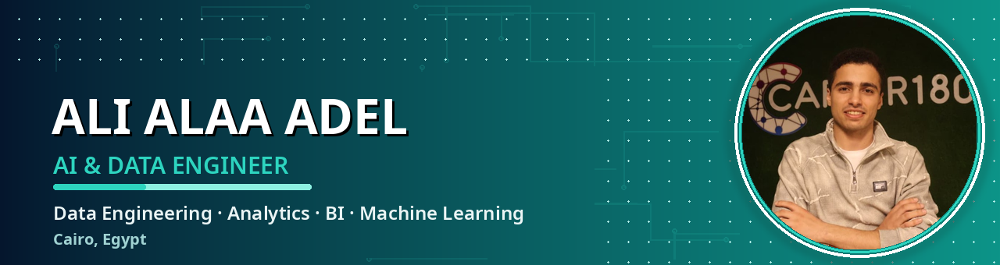

&nbsp;

&nbsp;

---

## 👋 About Me

Computer Science graduate (Artificial Intelligence department, Arab Open University) working across **data engineering, analytics, BI, and machine learning**.

- 🔧 Recently completed a **Career 180 professional development internship** (with MINT by EGBANK) and an **Industrial AI & Data Engineer internship at Niotek**, applying machine learning to industrial IoT time-series data, predictive analytics, and Edge AI.
- 🧑‍🏫 Freelance **Programming Instructor** at Future kids, teaching programming and AI to kids and teens (200+ students).
- 🏗️ I build end-to-end solutions with **SQL, Python, ETL/ELT pipelines, data warehousing (Snowflake), orchestration (Airflow, dbt), Azure, and Power BI**.
- 🎯 Open to entry-level opportunities in Data Engineering, Analytics, and AI.

---

## 🏆 Achievements

- 🥇 **1st Place, Egypt Social Hackathon 2026**: National winner; team selected for the international stage alongside teams from 8 Euro-Mediterranean countries.
- 🥇 **1st Place, DEPI Data Engineering Final Project**: awarded for **Spirit of Ankh**, an end-to-end tourism intelligence platform (team project).

---

## 🛠️ Tech Stack

  

**Data Engineering**
`SQL` · `ETL/ELT` · `Data Warehousing` · `Data Modeling` · `Snowflake` · `Apache Airflow` · `dbt`

**Analytics & BI**
`Power BI` · `DAX` · `Power Query` · `Excel` · `Data Visualization`

**AI & Machine Learning**
`Machine Learning` · `Deep Learning` · `PyTorch` · `TensorFlow` · `Scikit-learn`

---

## 🚀 Featured Projects

<table>
<tr>
<td width="50%" valign="top">

### 🏺 [Spirit of Ankh](https://github.com/alialaa0/Spirit_of_Ankh)

**AI-Powered Tourism Intelligence Platform** · 🏆 1st Place, DEPI Data Engineering final project

End-to-end **Data Engineering + ML + BI** over **45 tourist locations and 580K+ records**: Airflow pipelines into Snowflake, crowd prediction (**R² ≈ 0.88**), Power BI dashboards, AI tourism assistant.

`Python` `SQL` `Snowflake` `Azure` `Airflow` `Docker` `Power BI`

</td>
<td width="50%" valign="top">

### 🏭 [Samsung Supply Chain Analytics](https://github.com/alialaa0/Samsung_Supply_Chain_Analytics)

**Power BI**

End-to-end supply chain BI across procurement, manufacturing, inventory, logistics, sales, and profitability: Galaxy Schema model, reusable DAX measures, interactive dashboards.

`Power BI` `DAX` `Data Modeling`

</td>
</tr>
<tr>
<td width="50%" valign="top">

### 🏦 [Bank Customer Churn Analysis](https://github.com/alialaa0/Bank-Customer-Churn-Analysis-Power-BI)

**Power BI**

Executive churn dashboard: financial impact across geography, demographics, credit score, and balances. Power Query cleaning, data modeling, DAX churn KPIs, dynamic filtering.

`Power BI` `DAX` `Power Query` `Excel`

</td>
<td width="50%" valign="top">

### 🗄️ [SQL Data Warehouse Project](https://github.com/alialaa0/sql-data-warehouse-project)

End-to-end data warehouse: ingesting data from source systems and landing it to target.

`SQL` `Data Warehousing` `ETL`

</td>
</tr>
<tr>
<td width="50%" valign="top">

### 🛒 [E-Commerce Sales Analysis](https://github.com/alialaa0/Sales_Dashboard_for_E-commerce_Business)

**Python**

End-to-end analysis of 2,000 transactions: preprocessing, KPI analysis, EDA, and an interactive **Dash/Plotly** dashboard filterable by region, sales rep, and product.

`Python` `Pandas` `Dash` `Plotly`

</td>
<td width="50%" valign="top">

### 🤖 [Asset Management AI](https://github.com/alialaa0/asset-management-ai)

**LangChain + FastAPI**

Secure natural-language query layer over an asset inventory: validated structured queries instead of raw LLM SQL, PostgreSQL, REST API with OpenAPI docs.

`Python` `LangChain` `FastAPI` `PostgreSQL`

</td>
</tr>
<tr>
<td width="50%" valign="top">

### 🍕 [Pizza Sales Dashboard](https://github.com/alialaa0/pizza-sales-powerbi-dashboard)

**Power BI**

Interactive dashboard for sales performance, orders, products, and customer preferences.

`Power BI` `DAX` `Data Visualization`

</td>
<td width="50%" valign="top">

### 🌸 [Ferns & Petals Analysis](https://github.com/alialaa0/Ferns_And_Petals_Data_Analysis_with_Excel)

**Excel**

Sales analytics covering revenue, top products, customer spending, delivery time, and trends.

`Excel` `Power Query` `Power Pivot` `DAX`

</td>
</tr>
</table>

---

## 💼 Experience

| Role | Where | When |
|---|---|---|
| Internship Program Participant | **Career 180 · MINT by EGBANK** | Sep 2026 - Oct 2026 |
| Industrial AI & Data Engineer Intern | **Niotek** | Aug 2026 - Sep 2026 |
| Product Owner Intern | **Zedny** | Feb 2026 - Mar 2026 |
| Programming Instructor (Freelance) | **Future kids** | Feb 2024 - Apr 2025 |

---

## 🎓 Training

| Program | Track | When |
|---|---|---|
| **Digital Egypt Pioneers Initiative (DEPI)** | Data Engineering | Nov 2025 - Jun 2026 |
| **Digital Egypt Pioneers Initiative (DEPI)** | Data Science | Oct 2024 - May 2025 |
| **National Telecommunication Institute (NTI)** | Machine Learning & Data Science Intern | Sep 2024 - Oct 2024 |
| **Taheel (sponsored by IOM)** | Digital Marketing Intern (60-hour course) |  |

---

**Open to entry-level opportunities in Data Engineering, Analytics, and AI.**

<a href="https://www.linkedin.com/in/3li-3laa/">Let's connect →</a>

